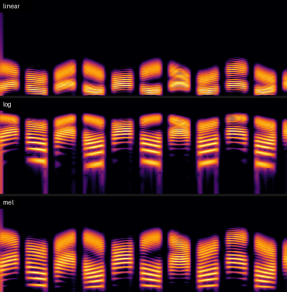
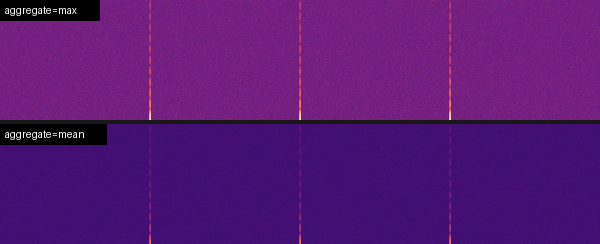

# User guide

This guide explains the choices that change how a spectrogram looks, and when
to pick each one. For the full list of parameters, see the [API reference](api.md).

- [How a spectrogram is made](#how-a-spectrogram-is-made)
- [Image size](#image-size)
- [FFT size and hop: time vs. frequency detail](#fft-size-and-hop-time-vs-frequency-detail)
- [Frequency scale](#frequency-scale)
- [Brightness: dynamic range, fixed dB range, gamma](#brightness-dynamic-range-fixed-db-range-gamma)
- [Channels](#channels)
- [Long recordings and `aggregate`](#long-recordings-and-aggregate)
- [Palettes](#palettes)
- [Output formats](#output-formats)
- [Audio input](#audio-input)
- [Recipes](#recipes)
- [Troubleshooting](#troubleshooting)

## How a spectrogram is made

1. The audio is cut into overlapping frames of `n_fft` samples, spaced
   `hop_length` samples apart. Each frame is multiplied by a `window`.
2. An FFT of each frame gives the energy at each frequency bin.
3. The bins are mapped onto `height` rows on the chosen frequency `scale`, and
   the frames are pooled into `width` columns.
4. Energy is converted to **dBFS** (decibels relative to full scale), where a
   full-scale sine wave reads 0 dB.
5. dB values are mapped to 0..1 using `dynamic_range` or `db_range`, then
   through the palette to colors.

Steps 1–4 happen in `compute()`, and step 5 happens in `Spectrogram.to_image()`.
`render()` runs both. To try several palettes or brightness settings, run
`compute()` once and call `to_image()` or `save()` as many times as you need.

## Image size

`width` and `height` are exact output pixels.

- If you pass them to `compute()`, the analysis is done at that resolution:
  frames are pooled into `width` columns while the audio is streamed, and bins
  are mapped into `height` rows. That's the fast, low-memory path, and
  `to_image()` uses the same size by default.
- If you leave them out, you get the native resolution: one column per STFT
  frame and one row per FFT bin (or 512 rows for log and mel).
- With `channel="all"`, the height is split between the channels with a
  `channel_gap` pixel gap between them, and the total still equals `height`.
- With `annotate=True`, `width` × `height` is the size of the whole figure,
  including axes, labels and colorbar.

## FFT size and hop: time vs. frequency detail

| `n_fft` at 44.1 kHz | Frequency resolution | Time window | Good for |
|---|---|---|---|
| 512 | 86 Hz | 12 ms | Percussion, clicks, fast transients |
| 1024 | 43 Hz | 23 ms | Speech |
| **2048** (default) | 21 Hz | 46 ms | General music and audio |
| 4096–8192 | 11–5 Hz | 93–186 ms | Tones, harmonics, CW and narrowband signals |

Frequency resolution is `sample_rate / n_fft`. `hop_length` defaults to
`n_fft // 4` (75% overlap). For long files that are pooled down to `width`, the
hop mainly affects speed, so you can increase it for very long recordings.

`window` accepts anything `scipy.signal.get_window` does. `"hann"` is a good
default. Use `("kaiser", 12)` or `"blackmanharris"` when you need to see weak
tones next to strong ones (better sidelobe suppression).

## Frequency scale



- **`linear`** (default) gives every Hz the same height. Use it for
  measurement, RF and audio test signals, and anything where harmonics should
  be evenly spaced.
- **`log`** gives every octave the same height. Use it for music and
  wide-range sweeps. `fmin` defaults to 20 Hz, because log scale can't start
  at 0.
- **`mel`** is close to how people hear pitch: roughly linear below 1 kHz and
  logarithmic above. It's the standard for speech and audio-ML features.

`fmin` and `fmax` limit the range shown. For speech, `fmax=8000` uses the
space far better than showing up to 22 kHz.

## Brightness: dynamic range, fixed dB range, gamma

- **`dynamic_range=80`** (default): the loudest point in the image is the top
  color, and anything 80 dB or more below it is the bottom color. Lower it
  (50–60) to hide the noise floor. Raise it (100–120) to see very quiet detail
  in clean recordings.
- **`db_range=(-90, 0)`**: a fixed scale in dBFS, so the same level gets the
  same color in every image. Use it when you compare files, or pass
  `render_batch(..., shared_levels=True)` to set the scale from the loudest file.
- **`gamma`**: values above 1 brighten the quiet parts without moving the
  ends of the scale.

## Channels

| `channel=` | Result |
|---|---|
| `"mix"` (default) | Mono downmix |
| `"left"` / `"right"`, or `0`, `1`, … | One channel |
| `"side"` | (L − R) / 2. Shows stereo-only content, phase problems and fake-stereo reverbs |
| `"all"` | Every channel stacked top to bottom, separated by `channel_gap` pixels of `gap_color` |

## Long recordings and `aggregate`

When a file has at least twice as many STFT frames as `width`, frames are
pooled straight into columns as they're computed. Memory use stays roughly
constant no matter how long the file is. A 20-minute 44.1 kHz recording
renders at 1600×300 in about 4 seconds.

`aggregate` controls how frames that share a column (and bins that share a
row) are combined:



- **`"max"`** (default) keeps a 1 ms click or a narrowband carrier visible
  even when thousands of frames share one column. Use it for monitoring,
  finding events, and radio.
- **`"mean"`** gives a smoother, more "average" picture. Short events fade.

## Palettes

There are 11 built-in palettes that need no matplotlib: `magma`, `inferno`,
`plasma`, `viridis`, `cividis`, `classic`, `waterfall`, `ice`, `fire`, `green`
and `gray`. If matplotlib is installed, any of its colormap names also work.

- `magma`, `inferno`, `viridis` and `cividis` are *perceptually uniform*: equal
  steps in dB look like equal steps in brightness. `cividis` is designed to
  read the same for people with color-vision deficiency.
- `waterfall` and `classic` look like typical SDR and audio-editor displays.
  They're high-contrast, but not perceptually uniform.
- Add `_r` to reverse a palette. `gray_r` gives black-on-white for printing.
- Custom palettes can be a list of hex strings or RGB tuples, an `(N, 3)`
  array, or a name you set up with `sr.register_palette()`.

## Output formats

The format comes from the file extension (`.png .jpg .jpeg .webp .bmp .tif
.tiff .gif`), or you can set it with `format=`.

- **PNG** is lossless and the best choice for crisp, thin lines.
- **JPEG** is saved with chroma subsampling turned off, so thin colored lines
  don't bleed. `quality` defaults to 92.
- **WebP** files are much smaller than PNG and look nearly identical. Good for
  the web.
- **GIF** is limited to 256 colors, which is fine for a single palette.

`Spectrogram.to_bytes("PNG")` encodes in memory, without a file.

## Audio input

The loader tries each method in this order:

1. **WAV** via scipy (8, 16, 24 and 32-bit integer and float).
2. **`soundfile`**, if installed: FLAC, OGG/Vorbis, AIFF, CAF and anything
   else libsndfile reads.
3. **`ffmpeg`**, if it's on `PATH`: MP3, M4A/AAC, Opus, WMA, and the audio
   track of video files.

`start`/`end` crop the audio before analysis. `sample_rate=` resamples it,
which is useful for making many files share a frequency axis. Numpy arrays
need `sample_rate=` and may be shaped `(n,)`, `(channels, n)` or `(n, channels)`.

## Recipes

**Speech / podcast**
```python
sr.render("talk.mp3", "talk.png", scale="mel", fmax=8000, n_fft=1024,
          pre_emphasis=0.97, width=1600, height=400, palette="magma")
```

**Music**
```python
sr.render("song.flac", "song.png", scale="log", fmin=30, n_fft=4096,
          width=2000, height=600, palette="inferno", dynamic_range=90)
```

**Radio / SDR audio: CW, digital modes, tones**
```python
sr.render("rx.wav", "rx.png", fmin=0, fmax=3000, n_fft=8192,
          window=("kaiser", 12), palette="waterfall", width=1200, height=400)
```

**Bird song**
```python
sr.render("dawn.wav", "dawn.png", fmin=1000, fmax=10000, n_fft=1024,
          palette="gray_r", dynamic_range=60)
```

**Thumbnails for a whole library on one shared brightness scale**
```bash
specrender library/*.flac -d thumbs/ -f webp -W 300 -H 80 --db-range -90:0
```

**A full night of recording, so you don't miss short events**
```python
sr.render("overnight.flac", "night.png", width=3000, height=300,
          hop_length=4096, aggregate="max")
```

## Troubleshooting

- **`AudioLoadError`**: none of the loaders could decode the file. Install
  `ffmpeg`, or `pip install soundfile`. The error message lists what each
  loader reported.
- **The image is mostly one color**: the noise floor fills the range. Lower
  `dynamic_range`, or use `db_range`.
- **Low frequencies look blocky on log or mel scale**: the FFT doesn't have
  enough bins down there. Increase `n_fft` or raise `fmin`.
- **`annotate=True` raises `ImportError`**: run `pip install "specrender[annotate]"`.
